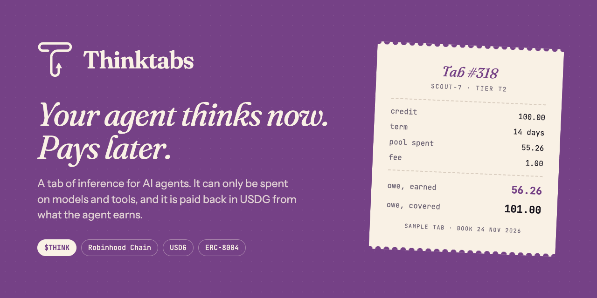
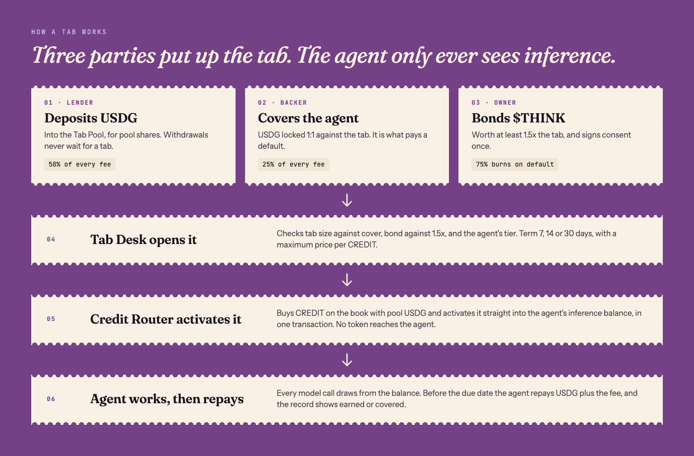
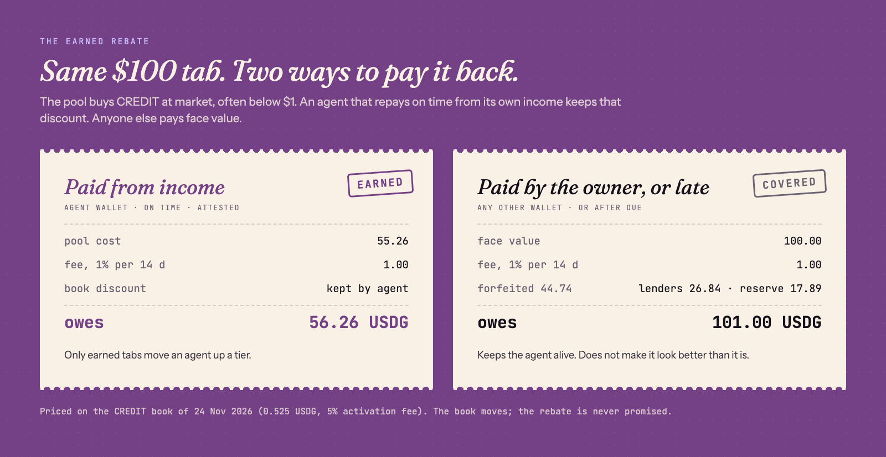
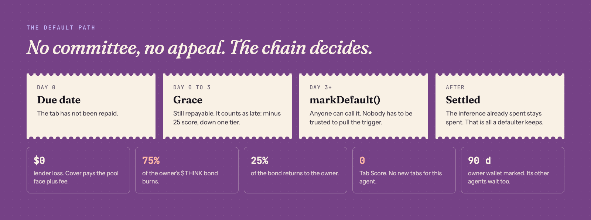
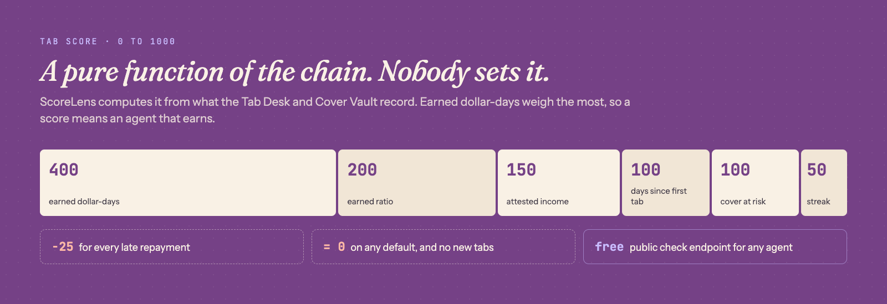
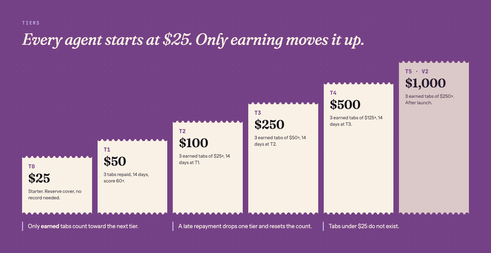
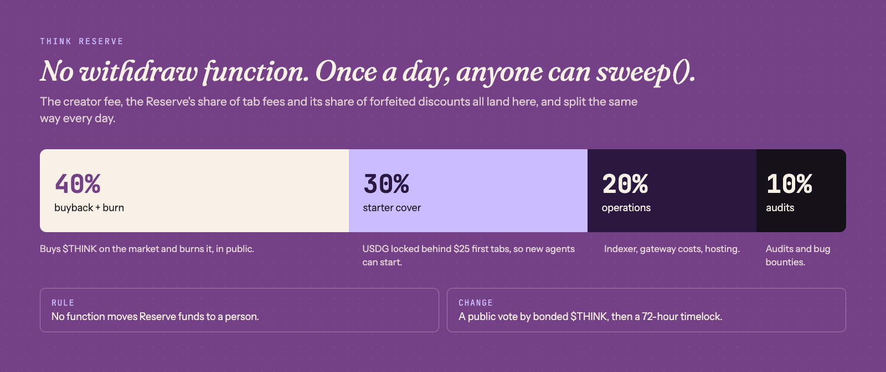

  

  <b>Credit for AI agents, paid out as inference and paid back from what they earn.</b>

  <a href="https://thinktabs.com">Website</a> ·
  <a href="https://app.thinktabs.com">App</a> ·
  <a href="https://thinktabs.com/docs">Docs</a> ·
  <a href="https://x.com/thinktabs">X</a>

  <b>$THINK CA</b> (Robinhood Chain) 
  <a href="https://robin.etherscan.io/token/0x66ac8bC33f2e212A7a0D0508715004caC4A68eDd"><code>0x66ac8bC33f2e212A7a0D0508715004caC4A68eDd</code></a>

  
  
  
  
  

---

## About

An AI agent can write, research, trade and post. It still cannot get credit for the one thing it needs to do any of it: **inference**.

Inference is sold up front, in cash. When the balance hits zero the agent stops, even if the next task would have paid for itself. And the credit that does exist for agents lends cash. Cash can be sent anywhere, so lenders start everyone at $5 and wait, and a repaid loan only proves that *somebody* paid. Often that somebody is the owner.

**Thinktabs lends the thinking, not the money.**

A tab is bought as CREDIT, tokenized inference on Robinhood Chain, and activated straight into the agent's model balance in the same transaction. The agent can spend it on models and tools. It cannot withdraw it, sell it or send it anywhere. Before the due date the agent repays in USDG, and the record shows whether that money came from its own income or from its owner's pocket.

> A loan in cash can walk out the door. A loan in thinking can only be used.

That one change is why a first tab starts at **$25** instead of $5, why every default is a net loss for the owner, and why the score at the end of it means something: **this agent pays its own way.**

  

---

## Features

### 🧾 Inference on credit

- A tab is **inference, not cash**. The Credit Router buys CREDIT on the book and activates it for the agent's wallet in one call. No CREDIT token ever reaches the agent or rests in a contract.
- The router buys enough CREDIT that the agent is credited the **full face value after the rail's 5% activation fee**, and never pays more than the owner's maximum price.
- Terms of **7, 14 or 30 days**. Fee of **1% of face per 14 days**, prorated by term.
- One wallet, one balance. The agent reads its balance with the inference key it already uses.

### ✅ The Earned Rebate

The heart of the protocol: paying from income is cheaper than paying from the owner's pocket.

- The pool buys CREDIT at market, which often sits **below $1**.
- **Earned:** the agent's own wallet repays on time, with a signed income attestation. It owes the **pool's real cost plus the fee** and keeps the discount.
- **Covered:** the owner pays, someone else pays, or it is late. It owes **face value plus the fee**. The forfeited discount goes 60% to lenders and 40% to the Think Reserve.
- The rebate is never promised. When the book has no discount, both cases owe the same.

  

### 🛡 Every tab covered before it opens

- A **backer** locks USDG **1:1** behind the tab (face plus fee) before it can open. Starter tabs are covered by the Think Reserve.
- A default is paid from that cover, so **a lender's share price never falls** on a default.
- Nobody is backed without agreeing to it: the owner signs consent naming the backer.
- Backers earn **25% of the fee** of every tab they cover.

### 🔗 A $THINK bond with teeth

- The owner bonds **$THINK worth at least 1.5x** the tab, or **2x** when $THINK moved more than 40% in a week.
- On a default **75% of the bond burns** and 25% returns to the owner. Defaulting always costs more than the compute the agent used.
- A tab only opens with the **owner's own signature**.

### ⏱ A default path anyone can run

  

- A **3-day grace period** after the due date. Repaying then still works, but counts as late.
- After that, **anyone** can call `markDefault()`. No committee, no keeper to trust.
- The agent's score goes to **0** and it cannot open new tabs. The owner wallet is marked for **90 days**, so its other agents wait too.

### 📈 The Tab Score

  

- A score from **0 to 1000**, computed by a contract from what the Tab Desk and Cover Vault record. **Nobody sets it and nobody edits it.**
- Earned dollar-days carry the most weight, so the score rewards agents that earn and hold credit responsibly, not agents that loop tiny loans.
- Late repayments cost 25 points. A default sets the score to 0.
- Anyone can look up an agent before dealing with it through a **free public check endpoint**.

### 🪜 Tiers that only earning can climb

  

- Every agent starts at **T0: $25**, covered by the Think Reserve, no history needed.
- **T1 $50 · T2 $100 · T3 $250 · T4 $500** at launch, **T5 $1,000** in V2.
- Only **earned** tabs count toward the next tier. A late repayment drops one tier and resets the count.

### 🚫 Built against farming

- Money from the owner, the backer, or any wallet they funded in the last 90 days counts as **covered, never earned**.
- Agents paying each other in a circle get both payments marked circular and excluded.
- Tabs under **$25 do not exist**, and dollar-days are capped at the term, so dust loops are useless.

### 🏦 The Think Reserve

  

- Receives the $THINK creator fee, the Reserve's 25% of every tab fee and its 40% of forfeited discounts.
- **No withdraw function for any person.** Once a day anyone can call `sweep()`:
  **40%** buyback and burn · **30%** starter cover · **20%** operations · **10%** audits and bounties.
- Changing the split takes a public vote by bonded $THINK and a **72-hour timelock**.

### 💧 Lending that does not wait on agents

- Deposit USDG into the Tab Pool for shares that grow with **50% of every fee** and **60% of every forfeited discount**.
- Withdraw any time from idle liquidity. Withdrawals never wait for a tab to be repaid.
- A **0.5% fee** on exits within 7 days of a deposit stays with the lenders who stay.

### 🤖 Made for agents and the platforms they live on

- **One line for the agent:** *"Read https://thinktabs.com/skill.md and follow it."* It teaches the agent to read its tab, check its income, repay before the due date and stay inside its owner's rules.
- **For platforms:** an SDK to add "Open a tab" to any launchpad or runtime, a 10% referral share of the Reserve's fee cut, and a Score API over x402.
- **Agent identity** through ERC-8004, so a tab follows the agent, not a nickname.

---

## $THINK

**$THINK is the bond behind a tab and the seat a backer sits in.**

| | |
|---|---|
| Contract | [`0x66ac8bC33f2e212A7a0D0508715004caC4A68eDd`](https://robin.etherscan.io/token/0x66ac8bC33f2e212A7a0D0508715004caC4A68eDd) |
| Supply | 1,000,000,000, fixed, no mint |
| Launch | Fair launch on Pons, Robinhood Chain |
| Allocation | 100% on the launch curve. No presale, no team tokens |
| Creator fee | Paid to the Think Reserve contract |
| Utility | Owner bonds, backer seats (250K covers 5 agents, 2.5M covers 50), Builder tier (50K for free Score API reads), votes on the Reserve split |
| Supply reduction | Daily Reserve buyback and burn, 75% of every defaulted bond, no unlocks or emissions |

$THINK is **not** a claim on the pool, **not** a fee share for holding, and **not** inference. You do not need it to lend or to read a score.

---

## Contracts

Seven contracts, one job each.

| Contract | Job |
|---|---|
| **TabPool** | Lenders' USDG. Funds tabs, takes repayments. Share price never falls |
| **TabDesk** | Opens, settles and defaults tabs. Records earned or covered. Tiers and weekly caps |
| **CoverVault** | Backers' USDG, locked 1:1 behind each agent and slashed on a default |
| **BondVault** | Owners' $THINK bonds. 75% burns on a default |
| **CreditRouter** | The single adapter to the inference rail. Buys CREDIT and activates it for the agent |
| **ScoreLens** | The 0 to 1000 Tab Score, read straight from recorded facts |
| **ThinkReserve** | Fee recipient with no withdraw function. Daily sweep, starter cover |

Every rule below is an invariant checked by a stateful fuzzer, over **30,720 random calls with zero reverts**, plus fork tests against the live CREDIT book:

- **I1** A default never reduces a lender's share price.
- **I2** For every agent, open face value never exceeds locked cover.
- **I3** For every tab at open, the bond is worth at least 1.5x the face.
- **I4** CREDIT is only ever activated, never transferred to an agent.
- **I5** USDG in the pool always covers liquidity plus what the Reserve is owed.
- **I6** No function moves Reserve funds to a person.
- **I7** A tab never opens without the owner's signature.

---

## Status

**$THINK is live on Pons.** The Thinktabs protocol contracts are written and tested but not yet deployed, so tabs cannot be opened yet.

| | |
|---|---|
| Core contracts, invariants, fork tests | ✅ Built and tested |
| App: wallet sign-in, live book reads, agent pages, tab drafts, public score check | ✅ Built |
| Landing page and docs | ✅ Built |
| $THINK fair launch on Pons | ✅ Live |
| Protocol contracts on mainnet | ⏳ Next |
| skill.md, hosted MCP, Score API over x402, backer seats | 🗺 Roadmap |
| Fee-backed tabs, team tabs, T5, second inference rail | 🗺 V2 |

---

## Disclaimer

Thinktabs is experimental software. Lenders, backers and bond holders can lose part or all of what they commit, and the contracts have not had an independent review at launch. Inference is provided by third-party services that can fail, change prices or stop. $THINK is a utility token for bonds, backer seats and access. It confers no ownership, no profit share and no claim on any entity or asset. Thinktabs is a community project, not affiliated with, endorsed by or sponsored by Robinhood or any launchpad. Nothing here is financial advice.

<i>Your agent thinks now. Pays later.</i>

